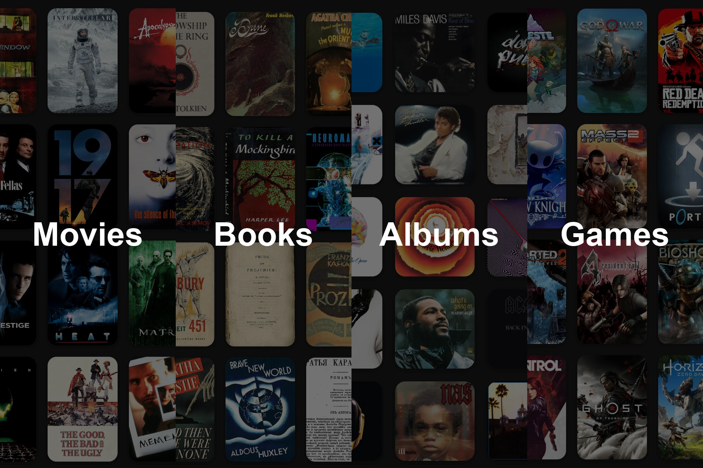
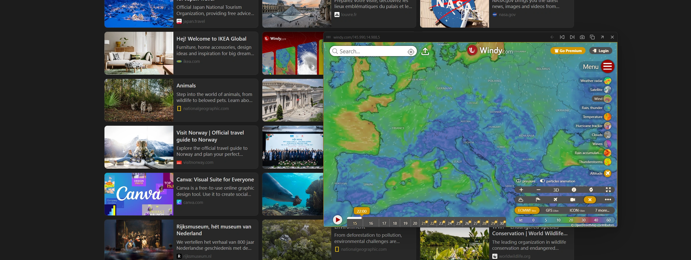
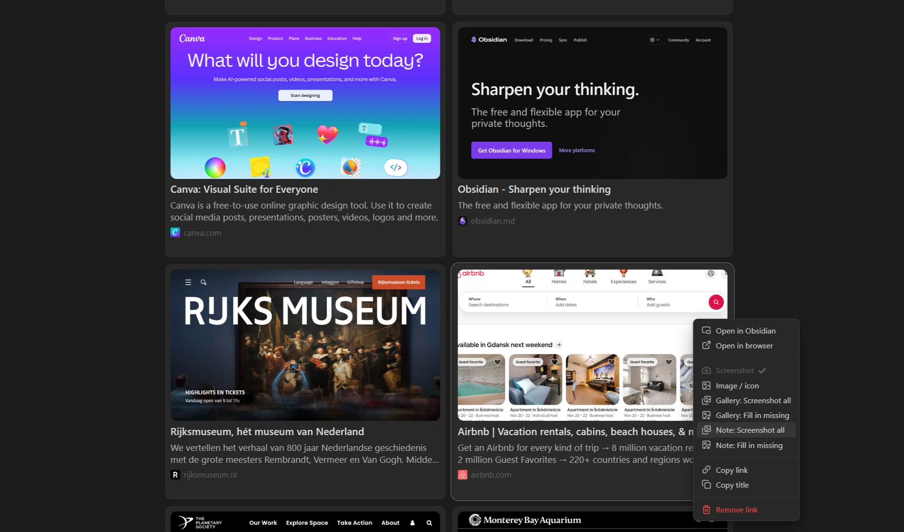

### Your website links, as a gallery of preview cards

Website links turn into a clean gallery with images, titles, descriptions and domains.



### Open any website without leaving your notes

Click a card to open the site in a floating window that you can drag, resize and keep open while you work.



### Screenshots as thumbnails

Replace a card's image with a screenshot of the page, for one link or a whole note at once.



### Extensive options

Adjust the card layout, spacing, hover effects, title size, screenshots and more.


Highlights

* **Preview cards** from plain links and Markdown links, with the website's image, title, description and domain.
* **Floating website window** you can drag, resize and browse in, without leaving your note.
* **Screenshot thumbnails** saved on your computer, with scrollbars and cookie banners hidden.
* **Gallery and note tools** that fill in missing pictures for many links at once.
* **Works out of the box.** No account or API key needed. Cards show in Reading View only.

### Features

#### Cards

* Links on their own lines, or in a list, become preview cards. Several links in a row become one gallery.
* Horizontal or vertical cards, 1 to 4 per row, three card backgrounds, spacing, title size and title lines.
* Hover effects: a highlight and an optional zoom on the image.
* If a site has no usable image, its favicon is shown instead.
* Works well on mobile, with the same layout settings as on desktop. If you sync your vault, it is recommended not to sync this plugin's settings, so you can keep different settings on your phone and your computer: with Obsidian Sync, leave community plugin syncing off (the default); with Git, add `.obsidian/plugins/website-link-gallery/data.json` to your `.gitignore`.

Each card's picture is chosen in this order:

1. Your saved screenshot of the page, if you took one
2. Image from the page (`og:image`, `twitter:image`, `image\\\\\\\\\\\\\\\_src`)
3. Icon declared by the page (apple-touch-icon / `rel="icon"`)
4. `/favicon.ico` of the site
5. Google favicon service

#### Floating window

* Opens from a card with **Open in Obsidian**. `Ctrl` / `Cmd` + click opens your browser instead.
* Drag it by the top bar and resize it from the sides or bottom.
* Links inside the website work, and links that would open a new tab load in the same window.
* Back, previous and next card, screenshot, copy link, open in browser and close buttons.
* The bar shows the domain, or the full address without `https://` if you turn that option on.
* It keeps its own browser session, separate from Obsidian's Web viewer and your normal browser.
* Desktop only.

#### Screenshots

* Loads the page in a hidden, desktop-sized browser, waits for it to settle and saves the top of the page as an image.
* Hides scrollbars and, if you leave the option on, cookie banners. Nothing is accepted or rejected.
* Saved as image files in the plugin folder, so they work offline. If a screenshot is missing on another device, the card falls back to the website's own image.
* The camera button in the floating window saves exactly what the window shows as that card's thumbnail.
* **Screenshot width** sets how wide the hidden browser is and how large the saved image can be.
* Desktop only.

#### Right-click menu

* **Open in Obsidian** and **Open in browser**.
* **Screenshot** takes or retakes a screenshot thumbnail for this card.
* **Image / icon** switches the card back to the website's own image or favicon.
* **Gallery: Screenshot all** and **Gallery: Fill in missing** work on every card in the gallery you clicked. Filling in missing only touches the cards that still need a picture.
* **Note: Screenshot all** and **Note: Fill in missing** do the same for every link in the note.
* **Copy link** and **Copy title**.
* **Remove link** deletes the line holding the link from the note, without leaving reading view.

#### Tools

* Choose which websites should stay normal links (YouTube links are skipped by default).
* Paste a lone website link and get a titled Markdown link automatically.
* Add missing titles to bare website links across your vault. Back up your vault first.
* Clear the saved page information. Screenshots are kept.

#### Usage

Put website links on their own lines:

```markdown
https://obsidian.md
https://github.com

https://www.nasa.gov
```

Markdown links work as well, and their text is used as the title:

```markdown
\\\\\\\\\\\\\\\[Obsidian Help](https://help.obsidian.md)
```

Links in a list work too, when the item holds only the link:

```markdown
- https://example.com
- \\\\\\\\\\\\\\\[Example docs](https://example.com/docs)
```

Links inside regular sentences are left untouched. Switch the note to Reading View to see the cards. All options are under **Settings → Website Link Gallery**.

#### Network use and privacy

The plugin needs the internet to build cards. It contacts:

* **The websites in your links**: it downloads each page to read its title, description and image, and your device loads each card's image and icon directly from the site.
* `www.google.com/s2/favicons` as the last fallback for a favicon.
* **The website itself** when you open it in the floating window or take a screenshot, using an embedded browser.

Page details are cached in the plugin's data file for 14 days so they aren't requested again. There is no analytics or tracking. Screenshots are saved as image files in the plugin's `screenshots` folder and never leave your computer.

#### Support

Found a bug or have a suggestion? Email [contact@kgniewek.com](mailto:contact@kgniewek.com).

If you enjoy the plugin, you can [buy me a coffee](https://buymeacoffee.com/kgniewek).

#### Disclaimer

Previews and screenshots show content from the websites you link to, which remains the property of its owners. You are responsible for using the plugin in line with those websites' terms.

#### License

Copyright (c) 2026 Krzysztof Gniewek (kgniewek). Licensed under the [PolyForm Strict License 1.0.0](LICENSE).

You can install and use the plugin for noncommercial purposes. The source is visible for transparency, but copying, redistributing or publishing modified versions, and commercial use, are not permitted.

Contributions are welcome. See [CONTRIBUTING.md](CONTRIBUTING.md).
