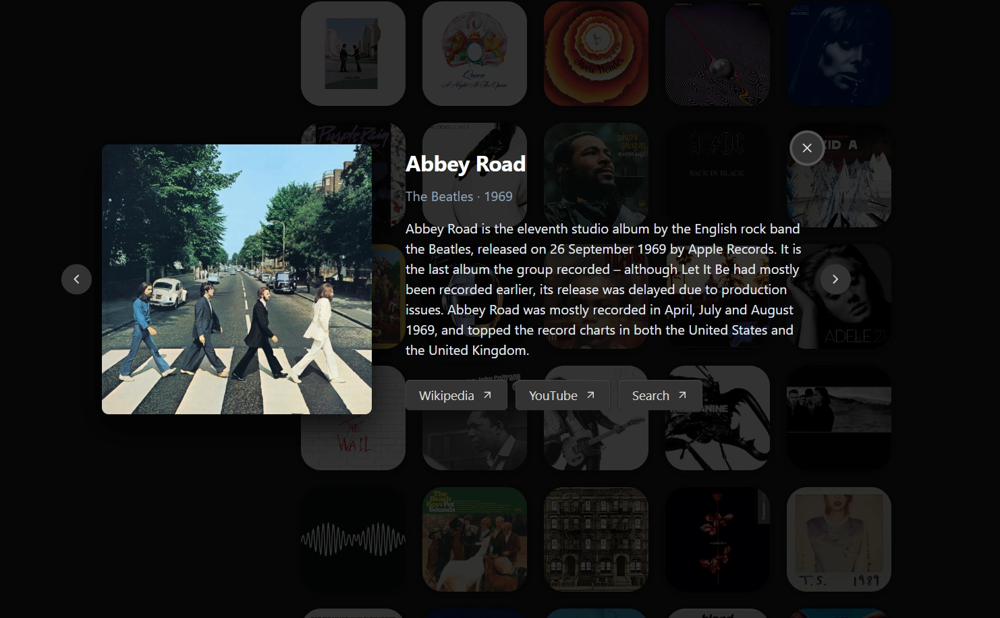
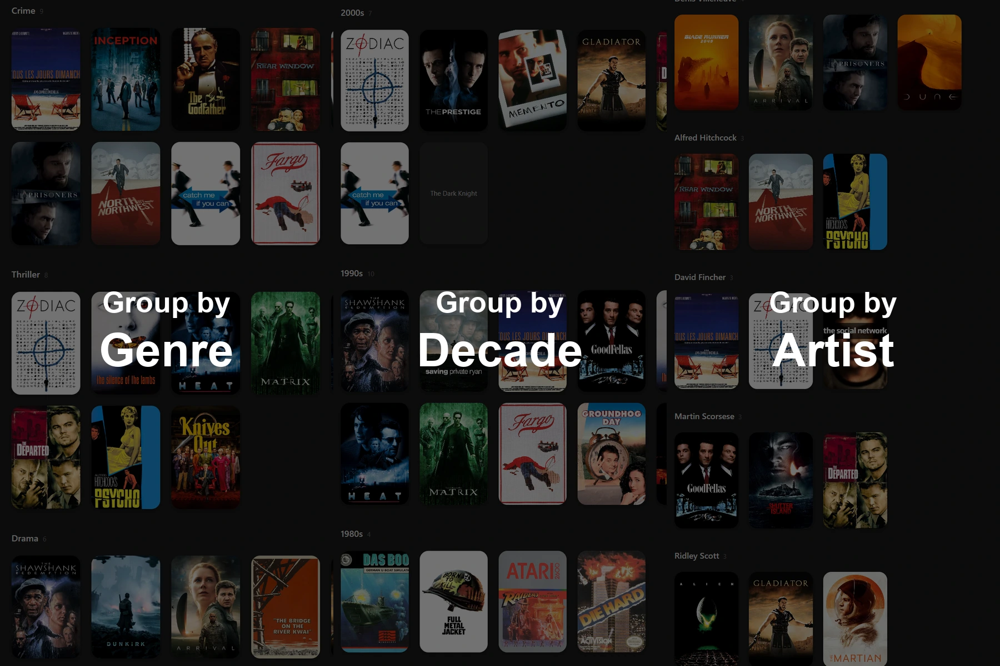
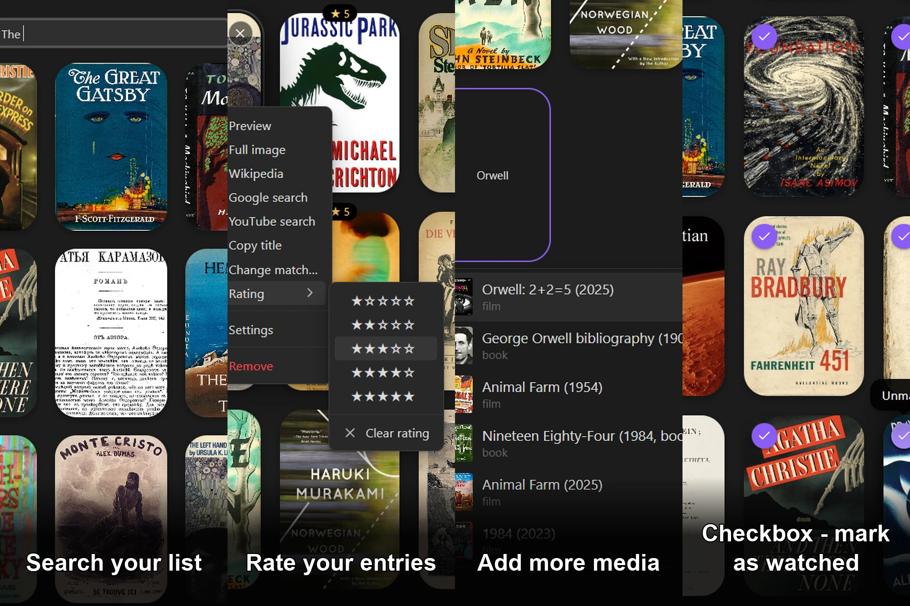
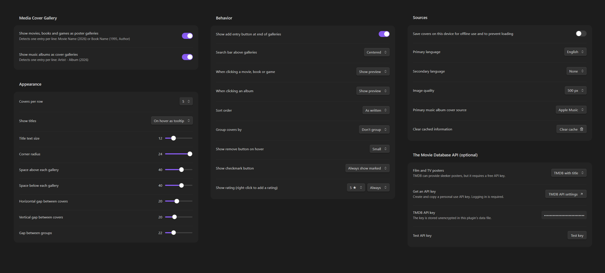

### Your movies, books, games and albums, as a wall of covers

Plain lines like `Pressure (2026)` turn into a clean gallery of posters and covers.


### Preview without leaving your notes

Click a cover for a larger view with a short description and links.



### Group your covers

Split a gallery by genre, decade or creator.



### Search, rate and check off

Search your list, rate entries, add more media and mark what you've watched.



### Simple on purpose

Adjust covers per row, spacing, corners, hover effects and titles.



Highlights

* **Movies, TV, books, games and albums** in one list. The plugin works out which is which.
* **Flexible titles**: as a tooltip, always below the cover, on hover below the cover, centered over a darkened cover on hover, or never.
* **Optional grouping** by genre, decade or director/author/artist/developer.
* **Click actions**: preview, full image, Wikipedia, YouTube, Google or nothing, set separately for albums.
* **Fetched details are cached**, so covers load instantly the next time. Covers can also be saved on your device for offline use.
* **Works out of the box.** No account or API key needed. Covers come from free public sources, and an optional free TMDB key gives sleeker film and TV posters.

### Features

#### Galleries

* Two or more consecutive lines in the form `Title (Year)` become one gallery. Lines in a bullet list or a task list (`- [x] Dune (1965)`) work too.
* The simplest gallery is a few movies, one per line:

```text
Heat (1995)
The Matrix (1999)
Gladiator (2000)
Pressure (2026)
```

* Albums are written `Artist - Album (Year)` and get square covers:

```text
Daft Punk - Discovery (2001)
Radiohead - OK Computer (1997)
Nirvana - Nevermind (1991)
```

  Leave an empty line between lists and each one becomes its own gallery. Books and games are written the same way as movies, and the plugin works out which is which. Mixing them in one list works too:

```text
Heat (1995)
Dune (1965, book)
Doom (2016)
```

* Or use a code block. Here the year is optional:

````markdown
```movies
Pressure (2026)
The Return (2024)
Enemy at the Gates (2001)
```
````

  Code blocks named `movies`, `tv`, `series`, `shows`, `books`, `games` or `albums` work the same way. The `tv`, `series`, `shows`, `books`, `games` and `albums` blocks assume that type.

* **Optional:** if the plugin picks the wrong one (a movie instead of the book, say), add a tag after the year. It is never required.

```text
The Lord of the Rings (2001, film)
The Lord of the Rings (1954, book)
Doom (2016, game)
Title (2020, album)
```

  Accepted tags: `film`, `movie`, `tv`, `series`, `show`, `book`, `novel`, `game`, `album`, `ep`.

* **Or add the director, author or developer** instead of a tag. A surname is enough, and the plugin picks the Wikipedia page that mentions that name:

```text
Dune (1965, Frank Herbert)
Dune (1984, David Lynch)
The Shining (1977, King)
The Shining (1980, Kubrick)
```

  Separate several names with a comma or `&`. A name can be combined with a tag, in any order, for example `Dune (1965, book, Herbert)`. For a list made up entirely of one type, a `books`, `games` or `albums` code block is simpler than tagging every line.
* Lines that are not entries, like a director's name, become small headings, and the entries below them form their own gallery. In a code block, start a line with `#` for a heading.
* 2 to 8 covers per row (up to 4 on mobile), spacing, corner radius, title size, order (as written, newest, oldest, A to Z).
* Titles: never, always below the cover, on hover below the cover, tooltip on hover, or centered on hover.
* Search bar above each gallery (aligned left or centered). It filters the covers below it as you type, by title, year, note, genre or creator, and shows how many match.
* Remove button: an x in the top right corner of a cover on hover, in a **Big** size (sticking out of the corner) or a **Small** one (inside the cover, the same size as the checkmark button).
* Checkmark button: a round button in the top left corner of a cover, set under **Show checkmark button** to **On hover** (marks only show while you hover a cover) or **Always show marked** (marked covers keep a filled checkmark). Click it to mark an entry as done. It checks or unchecks the `- [x]` box in your note, and adds one if the line has none. Setting it to Off hides all marks (your note is not changed).
* Rating: choose five stars or ten points under Settings, then right-click a cover and pick **Rating**. It is saved in the note as `4/5` or `9/10` and shown at the top of the cover, always or only on hover.
* Add button: a dashed cover at the end of a gallery. Click it, start typing a title and pick a suggestion from Wikipedia. The correctly formatted line, with the year, is added to your note after the last entry. If you press Enter with no suggestion selected, the text you typed is added as long as it is written as `Title (Year)`.
* Shadow on hover.

#### Albums

Album lines must be written `Artist - Album (Year)`. Covers are square.

Albums are looked up on both Wikipedia and Apple Music, so more albums are found, including ones that have no Wikipedia page. Under **Sources** you can choose your preferred source for album covers, Apple Music or Wikipedia.

#### Click actions

Under **Settings → Media Cover Gallery → Behavior**, choose what a click does, separately for movies, books and games and for albums:

* Show preview
* Show full image
* Open on Wikipedia
* Search on YouTube
* Search on Google
* Do nothing

Hold Ctrl (or Cmd on Mac) while clicking to open the Wikipedia page instead.

In the preview and full image views, use the arrow buttons or the left and right arrow keys to go to the previous or next cover. Press Escape to close.

#### Grouping

Under **Settings → Media Cover Gallery → Group covers by**, split a list into sections:

* **Genre**: action, thriller, fantasy, shooter, rock and so on
* **Decade**
* **Director / author / artist / developer**: creators with only one entry go into **Other**

Genre and creator come from Wikidata and are cached. Coverage varies, especially for games and albums. Anything unmatched goes to **Other**.

#### Right-click menu

* Preview, full image, open on Wikipedia (or Open Library for books found there), search on Google, search on YouTube, copy title, settings, and **Rating** when ratings are on.
* **Change match…** lets you search Wikipedia and pick the right entry when a cover is wrong. The line in your note is rewritten to match your choice, and any note you added after `|` is kept.
* With grouping by genre or director/author/artist/developer, the menu also has **Refresh genres** or **Refresh creators**.
* **Remove** deletes the line from your note, with an Undo button for a few seconds.
* If nothing is found, the cover shows its title and clicking it searches Wikipedia.

#### Languages and image quality

* Choose a primary Wikipedia language and an optional secondary one. The secondary language is used when the primary has no cover.
* Choose the image quality for gallery covers, from 250 px to 960 px. Previews and full images use higher resolutions.

#### Saving covers and the cache

* **Save covers on this device** keeps the cover images in the plugin folder, so they work offline and do not need to be loaded again.
* **Clear cache** removes cached details and any saved covers.

#### Film and TV posters from TMDB (optional)

If you add a free [TMDB API key](https://www.themoviedb.org/settings/api), film and TV posters can come from The Movie Database instead of Wikipedia. Choose between:

* **TMDB with title**
* **TMDB in original language**
* **TMDB textless**

Use **Test key** to check that the key works. If TMDB has no match, or rejects the key, the plugin falls back to Wikipedia. The key is stored unencrypted in the plugin's data file.

#### Installation

**From Community plugins**

1. Open **Settings → Community plugins** and turn off Restricted mode.
2. Select **Browse**, search for **Media Cover Gallery**, then **Install** and **Enable**.

**Manually**

1. Download `main.js`, `manifest.json` and `styles.css` from the latest release.
2. Put them in `<your vault>/.obsidian/plugins/media-cover-gallery/`.
3. Reload Obsidian and enable the plugin under **Settings → Community plugins**.

#### Usage

Write your list. Galleries show in Reading View and in Live Preview. All options are under **Settings → Media Cover Gallery**. You can also open them from the ribbon icon or the **Open settings** command.

In Live Preview a gallery turns back into plain text while your cursor is inside it, so you can edit the lines. Move the cursor out, or use the small pencil button at the top left of the gallery, to switch between the two.

If you sync your vault, you may prefer not to sync this plugin's settings, so your phone and computer can look different. With Obsidian Sync, leave community plugin syncing off (the default). With Git, add `.obsidian/plugins/media-cover-gallery/data.json` to your `.gitignore`.

#### Network use and privacy

The plugin needs the internet to show covers. It contacts:

* `en.wikipedia.org` (API) for details, plus up to one other language edition (for example `pl.wikipedia.org`) if you pick a different main or second language in the settings
* `upload.wikimedia.org` for the images
* `itunes.apple.com` and Apple's image servers for albums that Wikipedia does not have, for album covers if you use Apple Music as the album cover source, and for larger album artwork
* `openlibrary.org` and `covers.openlibrary.org` for books only, and only when Wikipedia has no cover for them
* `www.wikidata.org` for genre and director, only when you use grouping by genre or creator, or **Change match…**
* `api.themoviedb.org` and `image.tmdb.org` for film and TV posters, only if you add a TMDB API key and choose a TMDB poster option
* `wikipedia.org`, `www.imdb.com` (films), `www.google.com` and `www.youtube.com` only when you open a link from a cover or use a search from the right-click menu

There is no account, no analytics and no tracking. Fetched details are cached in the plugin's data file for 30 days (unmatched titles for 1 day), or for a year when saving covers on your device is turned on.

#### Limitations

* Source mode always shows the plain text. Galleries show in Reading View and Live Preview.
* In Live Preview, plain lines that contain formatting (bold, links, highlights) are left as text, the same as in Reading View.
* Matching is done by title and year on Wikipedia. For very common titles, add the year, a tag like `(2016, game)`, or the creator's name like `(1984, David Lynch)`. If a cover is still wrong, use **Change match…** from the right-click menu.
* Some very new or obscure titles may have no cover and will show their title instead.
* For books, the year is the first publication year. Remakes and adaptations share titles, so add the year, a tag like `(1965, book)`, or the author like `(1965, Herbert)`.
* Names are checked against the introduction of the Wikipedia article, which works best with English Wikipedia. If a name does not match anything, the plugin falls back to the year and tag.
* Plain lines are only detected when at least two lines in a row match. For a single entry, use a code block.
* Open Library covers are matched by title, year (within 3 years) and author, so for common book titles add the year or the author, like `(1965, Herbert)`.
* Albums are matched by artist and album title, so write the artist and title the way Wikipedia or Apple Music lists them. Albums found only on Apple Music have no description or genre, so they land in **Other** when grouped by genre.
* Genre and creator data is incomplete on Wikidata, so some items land in **Other**.
* TMDB posters are only used for films and TV series.

#### Short notes

Add a few words after a `|` to keep a note or rating with an entry, for example `Wings (1927) | First movie to win an Oscar` or `Dune (1965, book) | 9/10`. The note shows next to the title (in the tooltip or under the cover, depending on your title setting) and in the preview window. There is no setting for it. A rating such as `9/10` or `4/5` in the note is shown on the cover when **Show rating** is on.

#### Support

Found a bug or have a suggestion? Email [contact@kgniewek.com](mailto:contact@kgniewek.com).

If you enjoy the plugin, you can [buy me a coffee](https://buymeacoffee.com/kgniewek).

#### Disclaimer

Details and images come from Wikipedia (text under CC BY-SA; covers and posters belong to their rights holders), Wikidata (CC0), and, if enabled, Apple Music, Open Library and The Movie Database. This product uses the TMDB API but is not endorsed or certified by TMDB. Titles, posters and covers remain the property of their owners.

#### License

Copyright (c) 2026 Krzysztof Gniewek (kgniewek). Licensed under the [PolyForm Strict License 1.0.0](LICENSE).

You can install and use the plugin for noncommercial purposes. The source is visible for transparency, but copying, redistributing or publishing modified versions, and commercial use, are not permitted.

Contributions are welcome. See [CONTRIBUTING.md](CONTRIBUTING.md).
