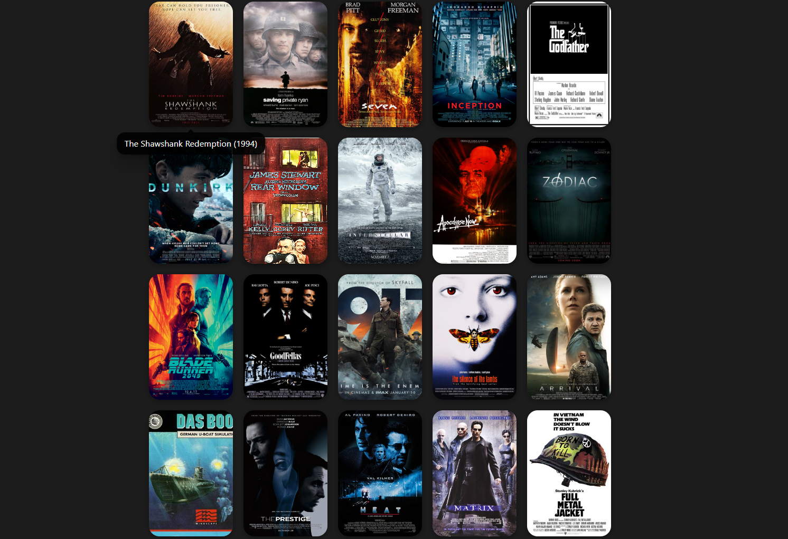
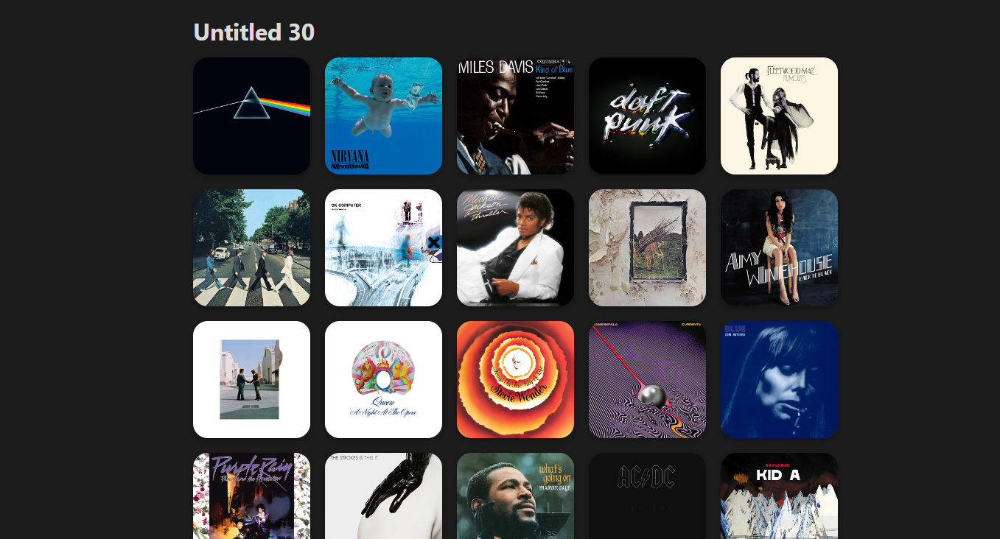
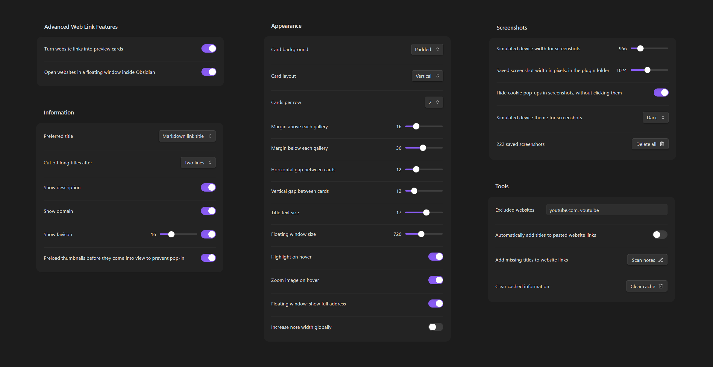

### Your movies, books, games and albums, as a wall of covers

Plain lines like `Pressure (2026)` turn into a clean gallery of posters and covers. Nothing to set up.



### Works out of the box

**No account. No API key. No sign-up.** Install, write a list, done. Covers come from Wikipedia, which is free and public.

### Preview without leaving your notes

Click a cover for a larger view with a short description and a link to Wikipedia.



### Simple on purpose

Adjust covers per row, spacing, corners, hover effects and titles. That's it.



Highlights

* **Movies, books, games and albums** in one list. The plugin works out which is which.
* **Titles on hover by default**, as a tooltip. You can also show them always below the cover, on hover below the cover, centered over a darkened cover on hover, or never.
* **Optional grouping** by type, genre, decade or director/author/artist/developer.
* **Fetched details are cached**, so covers load instantly the next time.

### Features

#### Galleries

* Two or more consecutive lines in the form `Title (Year)` become one gallery. Lines in a bullet list work too.
* Albums are written `Artist - Album (Year)` and get square covers:

```text
Heat (1995)
Dune (1965, book)
Doom (2016)
Daft Punk - Discovery (2001)
```

* Or use a code block. Here the year is optional:

````markdown
```movies
Pressure (2026)
The Return (2024)
Enemy at the Gates (2001)
```
````

  Code blocks named `books`, `games` or `albums` work the same way and assume that type.

* **Optional:** if the plugin picks the wrong one (a movie instead of the book, say), add a tag after the year. It is never required.

```text
The Lord of the Rings (2001, film)
The Lord of the Rings (1954, book)
Doom (2016, game)
Title (2020, album)
```

  Accepted tags: `film`, `movie`, `book`, `novel`, `game`, `album`, `ep`.
* Lines that are not entries, like a director's name, become small headings, and the entries below them form their own gallery. In a code block, start a line with `#` for a heading.
* 2 to 8 covers per row (up to 4 on mobile), spacing, corner radius, order (as written, newest, oldest, A to Z).
* Titles: never, always below the cover, on hover below the cover, tooltip on hover, or centered on hover.
* Optional remove button: a small x in the top right corner of a cover on hover (off by default).
* Shadow on hover.

#### Albums

Album lines must be written `Artist - Album (Year)`. Covers are square and come from Wikipedia.

#### Grouping

Under **Settings → Media Cover Gallery → Group by**, split a list into sections:

* **Genre**: action, thriller, fantasy, shooter, rock and so on
* **Decade**
* **Director / author / artist / developer**

Genre and creator come from Wikidata and are cached. Coverage varies, especially for games and albums. Anything unmatched goes to **Other**.

#### Right-click menu

* Preview, full image, open on Wikipedia, search on Google, search on YouTube, copy title.
* **Fetch again** re-downloads that cover. It only shows when grouping is on. With grouping by genre or director/author/artist/developer you also get **Refresh genres** or **Refresh creators**.
* **Remove** deletes the line from your note, with an Undo button for a few seconds.
* If nothing is found, the cover shows its title and clicking it searches Wikipedia.

#### Installation

**From Community plugins**

1. Open **Settings → Community plugins** and turn off Restricted mode.
2. Select **Browse**, search for **Media Cover Gallery**, then **Install** and **Enable**.

**Manually**

1. Download `main.js`, `manifest.json` and `styles.css` from the latest release.
2. Put them in `<your vault>/.obsidian/plugins/media-cover-gallery/`.
3. Reload Obsidian and enable the plugin under **Settings → Community plugins**.

#### Usage

Write your list and switch the note to Reading View. All options are under **Settings → Media Cover Gallery**.

If you sync your vault, you may prefer not to sync this plugin's settings, so your phone and computer can look different. With Obsidian Sync, leave community plugin syncing off (the default). With Git, add `.obsidian/plugins/media-cover-gallery/data.json` to your `.gitignore`.

#### Network use and privacy

The plugin needs the internet to show covers. It contacts:

* `en.wikipedia.org` (API) for details, plus up to one other language edition (for example `pl.wikipedia.org`) if you pick a different main or second language in the settings
* `upload.wikimedia.org` for the images
* `itunes.apple.com` for larger album artwork, only when you open an album's full image
* `www.wikidata.org` for genre and director, only when you use grouping by genre or creator
* `wikipedia.org`, `www.imdb.com` (films), `www.google.com` and `www.youtube.com` only when you open a link from a cover or use a search from the right-click menu

There is no account, no API key, no analytics and no tracking. Fetched details are cached in the plugin's data file for 30 days (unmatched titles for 1 day).

#### Limitations

* Galleries show in Reading View only, not in Live Preview or Source mode.
* Matching is done by title and year on Wikipedia. For very common titles, add the year, or a tag like `(2016, game)`.
* Some very new or obscure titles may have no cover and will show their title instead.
* For books, the year is the first publication year. Remakes and adaptations share titles, so add the year or a tag like `(1965, book)`.
* Plain lines are only detected when at least two lines in a row match. For a single entry, use a code block.
* Genre and creator data is incomplete on Wikidata, so some items land in **Other**.

#### Support

Found a bug or have a suggestion? Email [contact@kgniewek.com](mailto:contact@kgniewek.com).

If you enjoy the plugin, you can [buy me a coffee](https://buymeacoffee.com/kgniewek).

#### Disclaimer

Details and images come from Wikipedia (text under CC BY-SA; covers and posters belong to their rights holders) and Wikidata (CC0). Titles, posters and covers remain the property of their owners.

#### License

Copyright (c) 2026 Krzysztof Gniewek (kgniewek). Licensed under the [PolyForm Strict License 1.0.0](LICENSE).

You can install and use the plugin for noncommercial purposes. The source is visible for transparency, but copying, redistributing or publishing modified versions, and commercial use, are not permitted.

Contributions are welcome. See [CONTRIBUTING.md](CONTRIBUTING.md).
